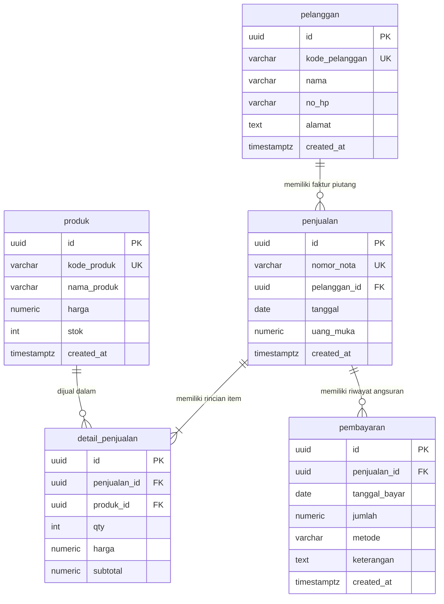

# Sistem Akuntansi Utang dan Pembayaran

Sistem informasi akuntansi berbasis web untuk pencatatan dan monitoring transaksi **penjualan kredit**, **piutang usaha**, serta **pembayaran angsuran dan pelunasan piutang pelanggan**.

Sistem ini terhubung langsung ke **Supabase PostgreSQL Cloud** dan mendukung pemrosesan transaksi secara *real-time*.

---

## 🏗️ Struktur Proyek

```text
Sistem Akuntansi Utang dan Pembayaran/
├── Back End/
│   ├── app.js             # Server backend Node.js mandiri (zero external dependencies)
│   └── SQL/
│       └── schema.sql     # Skrip DDL PostgreSQL (Tabel, Views, Triggers, RLS)
├── Front End/
│   ├── CSS/
│   │   └── style.css      # Styling modern antarmuka dashboard, tabel, & cetak faktur
│   ├── HTML/
│   │   └── index.html     # Antarmuka web akuntansi (Dashboard, Nota, Pembayaran, Pelanggan, Produk)
│   └── JS/
│       └── script.js      # Controller client-side (Supabase JS CDN & logika akuntansi)
├── index.html             # Pintasan root aplikasi
├── .gitignore
└── README.md
```

---

## 📊 Entity Relationship Diagram (ERD) - 5 Entitas

Sistem ini dirancang menggunakan 5 entitas utama akuntansi penjualan kredit dan piutang:



### Logika Akuntansi & View `v_utang`
* **Piutang Awal**: $\text{Total Penjualan} - \text{Uang Muka (DP)}$
* **Total Pembayaran**: $\sum(\text{Pembayaran Angsuran})$
* **Sisa Utang**: $\text{Total Penjualan} - \text{Uang Muka} - \text{Total Pembayaran}$
* **Status Piutang**:
  * **Lunas**: jika Sisa Utang $\le 0$.
  * **Sebagian**: jika Sisa Utang $> 0$ dan sudah ada Uang Muka atau Pembayaran.
  * **Belum Lunas**: jika Uang Muka $= 0$ dan belum ada pembayaran.

---

## 🚀 Fitur Utama

1. **Dashboard Akuntansi**: Menampilkan ringkasan metrik Total Penjualan Kredit, Total Kas Masuk, Sisa Piutang Berjalan, serta distribusi status faktur.
2. **Buku Pembantu Piutang (`v_utang`)**: Tabel pemantauan status piutang dan sisa utang secara rinci dengan pencarian dan filter status.
3. **Faktur Penjualan Kredit Baru**: Form pembuatan nota penjualan multi-barang otomatis dengan kalkulasi subtotal dan uang muka (DP).
4. **Pencatatan Pembayaran Utang**: Input angsuran bertahap atau pelunasan dengan tombol *Bayar Lunas Sekaligus*.
5. **Master Data Pelanggan**: Pencatatan debitur beserta fitur Buku Kartu Piutang per pelanggan.
6. **Master Data Produk**: Manajemen katalog produk dengan pembaruan otomatis sisa stok.
7. **Cetak Faktur & Kuitansi**: Tata letak ramah cetak (*print-ready layout*) untuk kuitansi transaksi dan kartu piutang.

---

## 💻 Cara Menjalankan

### Opsi 1: Buka Langsung di Browser
Klik dua kali file `index.html` atau buka file `Front End/HTML/index.html` menggunakan Google Chrome / Microsoft Edge / Live Server di VS Code.

### Opsi 2: Jalankan via Server Node.js
```bash
node "Back End/app.js"
```
Buka browser pada alamat `http://localhost:3000`.
